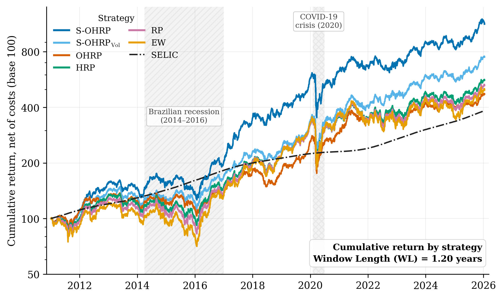
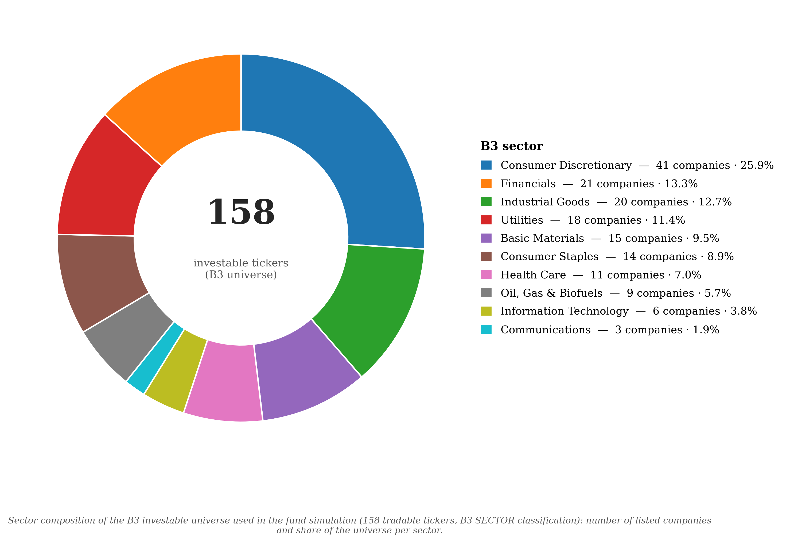

# OHRP 📈

### Hi! This is the OHRP library, where the code behind our research is made available for the community to analyze, test and extend 🤗

It implements the **Orthogonal Hierarchical Risk Parity** method published in *IEEE Access* and
now also carries **S-OHRP** and the **Sectoral Gini Index**, together with everything needed to
reproduce the experiments reported in my master's dissertation at PPGC/UFRGS.

As always, this is ongoing research and there is plenty left to improve. Contributions, questions
and issues are very welcome — please do get in touch. Only freely available data is included.

---

## What is in here 🧠

Three methods are implemented on top of the classical Hierarchical Risk Parity pipeline.

**OHRP — Orthogonal Hierarchical Risk Parity.** Instead of modifying the HRP machinery, OHRP
changes *what HRP sees*. Asset returns are projected onto a lower-dimensional orthogonal subspace
that preserves data locality (PCA followed by OLPP), and only then handed to hierarchical
clustering, quasi-diagonalization and recursive bisection. The projection parameters
`(k, d, r)` are re-optimized in-sample at **every** rebalancing, which turns a static
preprocessing step into an adaptive component of the strategy.

**S-OHRP — Sectoral OHRP.** A strict generalization of OHRP along two axes. First, the locality
graph only admits **intra-sector** edges, injecting an economic prior into the learned
representation and blocking the spurious cross-sector neighbours that hurt most when data are
scarce. Second, the in-sample selection is unified into a `δ·F` framework, where `δ` sets the
direction of the search and `F` is *any* scalar portfolio objective — so criteria such as the
Sharpe ratio become admissible alongside variance. Setting the sector partition to the whole
universe recovers OHRP exactly.

**SGI — Sectoral Gini Index.** A concentration measure that applies the Gini operator to
*sector-level aggregate weights*. It exposes something the asset-level Gini structurally cannot
see: a portfolio can be spread across dozens of tickers and still have its weight clustered in a
single economic sector. Running `tutorialSimpleOHRP.py` makes the point immediately — the equally
weighted portfolio scores a perfect `Gini = 0.00` and still lands at `SGI ≈ 0.31`.

---

## Out-of-sample results 📊

Cumulative returns of the six strategies at the 1.2-year estimation window, where S-OHRP reaches
the best risk-adjusted performance of the whole study. Solid lines are gross of costs, dashed
lines net of 3 bps per rebalancing.



Headline findings from the dissertation, over 158 Brazilian stocks from January 2011 to
February 2026 (composed ratios net of costs):

| | Result |
|---|---|
| **OHRP, risk** | Statistically significant lower volatility, smaller maximum drawdowns and lower Pain Index than HRP, RP and EW at every one of the nine long windows (1 to 5 years). Volatility of 0.158–0.169 across all windows tested, against 0.177–0.188 for HRP and ≈0.222 for EW |
| **OHRP, return** | Best Sharpe ratio at eight of the nine long windows, peaking at 0.343 (WL = 4.5 years) |
| **S-OHRP** | Best risk-adjusted performance of the entire study, Sharpe 0.482 at WL = 1.2 years, and the highest average over the short windows (0.327, against 0.255 for OHRP and 0.259 for HRP). S-OHRP (Vol) nearly matches it from 1.2 years on |
| **The price** | OHRP is the most concentrated at the asset level (Gini ≈ 0.70) and trades more than twice as much as HRP. S-OHRP trades even more |
| **SGI** | Risk Parity is the most sector-diversified strategy at every window. OHRP and, above all, S-OHRP concentrate their weight in few sectors, despite looking diversified at the asset level |

The investable universe, 158 tickers across 10 B3 economic sectors:



---

## Repository layout 🗂️

```
OHRP.py                      OHRP allocation method
SOHRP.py                     S-OHRP allocation method (sector-constrained, δ·F)
COLPP.py                     orthogonal locality-preserving projection core
HRP.py                       Hierarchical Risk Parity (de Prado, 2016)
RP.py                        Risk Parity benchmark (Ledoit-Wolf shrinkage)
EW.py                        Equally Weighted benchmark
Measures.py                  performance, drawdown and concentration metrics (incl. SGI)

simulationFund.py            the out-of-sample backtest driver
analise_experimentos.py      figures and statistical tables from the results
setores_b3.py                sector composition chart

tutorialSimpleOHRP.py        ① one window, every strategy, inspect the weights
tutorialSimulation.py        ② how the backtest works + a reduced-scale run
tutorialAnalysis.py          ③ how to turn results/ into figures and tables

tutorialDataExtraction.ipynb  how the price matrix and the SELIC series are downloaded

datasets/                    price, sector and risk-free data (see below)
results/                     simulation output behind every table and figure of the
                             dissertation, with the (k, d, r) selected at each rebalancing
docs/img/                    figures used by this README
```

The tutorials are plain `.py` files organised in `#%%` cells, so VS Code, Spyder and PyCharm all
render them as interactive notebooks while they stay readable in a plain diff.

`tutorialDataExtraction.ipynb` shows how the price matrix is built from Yahoo Finance and the
SELIC from the Brazilian Central Bank.

---

## Getting started 🚀

```bash
pip install -r requirements.txt
python tutorialSimpleOHRP.py
```

That builds one allocation per strategy on a single one-year window and prints the weight
structure, the two concentration measures and the sector mix. It finishes in about a minute and
confirms the environment is sound.

### Reproducing the dissertation

`results/` already holds the simulation output behind every table and figure of the dissertation,
so the analysis can be rerun straight away:

```bash
python analise_experimentos.py 1   # ExperimentoSOHRP: writes paper/figures and paper/tables
python analise_experimentos.py 2   # ExperimentoOHRP
python setores_b3.py
```

To recompute the simulation itself, fix the number of BLAS threads at one (see below) and run:

```bash
export OMP_NUM_THREADS=1 OPENBLAS_NUM_THREADS=1 MKL_NUM_THREADS=1 NUMEXPR_NUM_THREADS=1
python simulationFund.py
```

`simulationFund.py` runs both experiments:

| Experiment | Strategies | Window lengths |
|---|---|---|
| `ExperimentoSOHRP` | S-OHRP, S-OHRP (Vol), OHRP, HRP, EW, RP | 0.20 … 2.00 years, step 0.20 |
| `ExperimentoOHRP` | OHRP, HRP, EW, RP | 1.0 … 5.0 years, step 0.5 |

It skips any window length whose output already exists in `results/`, so remove the
corresponding `*_Ms_*` and `*_Ts_*` files to recompute a window, and an interrupted run can simply
be relaunched. The hyperparameter grid is 7 × 7 × 5 = 245 projections per method and rebalancing
date, and reproducing both experiments takes on the order of 80 CPU-hours on the reference machine.

**Protocol.** 158 Brazilian stocks (IBOV + SMLL) across 10 B3 sectors, January 2011 to February
2026, rolling windows of `WL × 252` trading days, 42-day holding periods giving 89 out-of-sample
portfolios per configuration, the grid `k ∈ {1, 3, …, 13}`, `d ∈ {5, 10, …, 35}`,
`r ∈ {0.92, 0.94, …, 1.00}`, a 90% minimum-observation filter, 3 bps of transaction cost, and
SELIC as the risk-free rate. Pairwise comparisons use the Wilcoxon signed-rank test at 95%, with
Student's paired *t*-test reported as a secondary reference.

---

## Reproducibility 🔬

### Reference environment

The dissertation results were produced on the machine below. `requirements-dissertation.txt` pins
the Python packages.

| | |
|---|---|
| OS | Ubuntu 24.04.2 LTS, Linux 6.8.0, x86-64, glibc 2.39 |
| CPU | Intel Core i7-14700 |
| Python | 3.11.13 (Miniconda) |
| Packages | numpy 2.3.0, scipy 1.16.1, pandas 2.3.0, scikit-learn 1.7.2, Riskfolio-Lib 7.0.1, cvxpy 1.7.2 |
| BLAS / LAPACK | OpenBLAS bundled with the pip wheels: 0.3.29 in numpy, 0.3.28 in scipy; `Haswell` kernel |
| BLAS threads | 1 |

In that environment the code reproduces `results/` exactly: OHRP, S-OHRP and S-OHRP (Vol)
recomputed from scratch at rebalancing dates spread over the whole sample select the same
`(k, d, r)` and the same weights, and the simulation output matches the stored files to the last
digit.

```bash
pip install -r requirements-dissertation.txt   # reference environment (Linux x86-64, Python 3.11)
pip install -r requirements.txt                # any platform, compatible recent versions
```

`requirements.txt` excludes pandas 3, which changes how returns are computed across price gaps.

### Why the number of threads and the platform matter

OHRP and S-OHRP select `(k, d, r)` by comparing in-sample objectives that often differ by a
fraction of a percent among the best candidates, so the selection is sensitive to perturbations at
the level of machine precision. A multithreaded BLAS splits sums and matrix products among threads
and combines the partial results in an order that depends on the number of threads. The
eigensolvers of the projection inherit these rounding differences, which can flip the sign of an
eigenvector (an arbitrary choice from the mathematical point of view) or, in S-OHRP, select a
different basis of an eigenspace with repeated eigenvalues, since its sector-restricted graph has
one connected component per sector. HRP clusters the projected coordinates by Pearson
correlation, which is not invariant to such sign changes, so a different `(k, d, r)` can win the
grid search, and from that rebalancing date onwards the whole portfolio path differs.

Running the same code on the same machine with all 28 hardware threads and with a single thread,
HRP, RP and EW agreed to within 4e-7, whereas the composed Sharpe ratio of OHRP and S-OHRP at an
individual window changed by a median of about 0.02 and by up to about 0.08 for OHRP and 0.17 for
S-OHRP. Averaged over the windows of each experiment, the changes largely cancel out. The same
mechanism explains why results differ across operating systems and across versions of the
numerical libraries, even with identical code.

In practice, the code runs on any platform and the methods behave as described in the
dissertation, but only the reference environment with a single BLAS thread reproduces its exact
OHRP and S-OHRP figures.

---

## Data 💾

Everything under `datasets/` is freely available data, pre-processed into ready-to-use matrices.

| File | Contents |
|---|---|
| `BR_equity_closing_prices.csv` | Daily adjusted closing prices, 158 tickers plus the IBOV and SELIC columns, 2002-01-01 to 2026-01-29. The dissertation uses the slice from 2011-01-03 onwards. |
| `SectoralBrazilianClassification.xlsx` | B3 economic sector for each ticker, matched by its reduced (4-letter) form |
| `SELIC_returns.csv` | Brazilian base interest rate, used as the risk-free benchmark |
| `IBOV_23-10-25.csv`, `SMLL_23-10-25.csv` | IBOV and Small Caps composition as of 2025-10-23 (ticker, Yahoo symbol, firm name, weight), used by `tutorialDataExtraction.ipynb` |
| `IBOV_equity_closing_prices.csv` | Daily closing prices of the IBOV constituents, 2010-01-04 to 2025-10-22, produced by `tutorialDataExtraction.ipynb` |

Only the data needed to replicate the dissertation and the data extraction notebook is included
here. The fundamentals database used in a separate line of experiments is deliberately left out.

---

## Citation 📚

If this code is useful to you, please cite the work it comes from.

**Journal article — the OHRP method**

> PERGHER, K. G. R.; SOLDERA, J.; SCHARCANSKI, J. An Orthogonal Hierarchical Risk Parity
> Allocation Method for Improved Portfolio Out-of-Sample Performance. **IEEE Access**, v. 14,
> 2026. DOI: [10.1109/ACCESS.2026.3656702](https://doi.org/10.1109/ACCESS.2026.3656702)

**Conference paper — where the idea started**

> PERGHER, K. G. R.; SOLDERA, J.; SCHARCANSKI, J. Dynamic Orthogonal Lower Dimensional
> Projections for Improving Hierarchical Risk Allocation and Out of Sample Portfolio Returns.
> In: **2025 IEEE Symposium Series on Computational Intelligence (SSCI)**, Computational
> Intelligence for Financial Engineering (CIFEr) track, Trondheim, Norway, 2025. p. 1–5.
> DOI: [10.1109/CiFerCompanion65204.2025.10980404](https://doi.org/10.1109/CiFerCompanion65204.2025.10980404)

**Under review — S-OHRP and the SGI**

> PERGHER, K. G. R.; SOLDERA, J.; SCHARCANSKI, J. Enhancing Orthogonal Hierarchical Risk Parity
> with Sectoral Information for Out-of-Sample Portfolio Allocation. Under review at
> **Operations Research Forum**, 2026.

**Dissertation**

> PERGHER, K. G. R. *Orthogonal Hierarchical Risk Parity Methods for Portfolio Allocation in the
> Brazilian Stock Market*. Master's dissertation, Programa de Pós-Graduação em Computação,
> Universidade Federal do Rio Grande do Sul, Porto Alegre, 2026. Advisor: Prof. Dr. Jacob
> Scharcanski.

---

Thanks for your support and curiosity! 🙏
